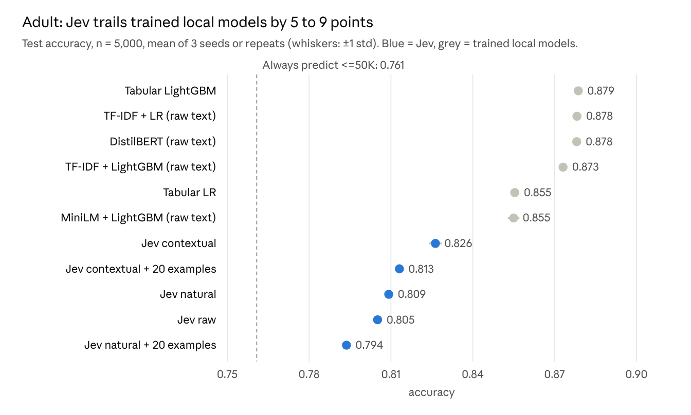
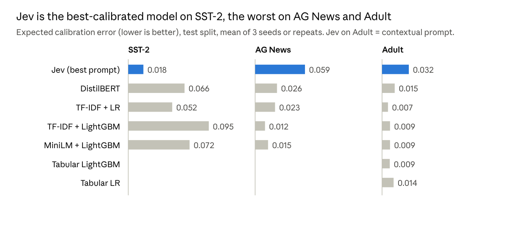

# Jev Benchmark Report

Oct 21, 2026

## Summary

Jev beats every local model on SST-2 sentiment (0.960 vs 0.905 for fine-tuned DistilBERT), trails on AG News topics by 5 points, and trails on tabular Adult income by 5.2–8.5 points. It needs no training data, but per prediction it costs about 1,000× more than DistilBERT (and far more than the classical models) and is 100–900× slower than local inference.

- **Text, home turf (Track A).** On SST-2, Jev is the best model tested by a clear margin: +5.7 points over DistilBERT (95% CI +3.8 to +7.7). It is also the best calibrated (ECE 0.018). On AG News it reaches 0.896, behind DistilBERT (0.946) and every classical baseline. Most of its errors there come from AG News's own label conventions rather than from misreading the articles.
- **Structured data (Track B).** On Adult, Jev's best prompt (contextual framing) reaches 0.826, against 0.879 for LightGBM on native features. The local text models lose almost nothing from serialization: TF-IDF+LR and DistilBERT on the raw text dump match LightGBM to within 0.1 point. So the gap is not caused by turning numbers into text. It comes from Jev being zero-shot on a task whose answer lives in the training-data statistics.
- **How the numbers are written matters little; context matters more.** Raw dump vs natural language: +0.4 points. Adding a paragraph of background facts: +1.7 points more. Twenty labeled examples raise ranking quality (AUC) but lower accuracy, at 5× the token cost.
- **Operational profile.** Jev answers in about 370 ms median per item and costs $0.015–0.096 per 1,000 predictions. Local models answer in 0.4–4 ms and cost under $0.00003 per 1,000 (rented-GPU equivalent), plus a one-off training cost of at most $0.016. Jev's repeats agree on 98.6–99.9% of labels.

Total API spend for the study: $4.11 ($3.99 on test, $0.12 on validation iteration).

## Setup

Three public datasets, six local models and seven frozen Jev prompts were scored on held-out test sets that no model or prompt saw during development.

| Task | Track | Labels | Train | Val | Test | Notes |
| --- | --- | --- | --- | --- | --- | --- |
| SST-2 | A, text | 2 | 65,349 | 2,000 | 872 | GLUE test labels are hidden, so the GLUE validation set is the test set. Val is carved from train. |
| AG News | A, text | 4 | 115,000 | 5,000 | 7,600 | Official test split. |
| UCI Adult | B, tabular | 2 | 41,842 | 2,000 | 5,000 | OpenML v2, stratified split. 24% earn >$50K. `fnlwgt` and `education-num` dropped for all models. |

| Model | Input | Trained on | Tracks |
| --- | --- | --- | --- |
| Tabular LR, Tabular LightGBM | Native features (one-hot / categorical) | Train split | B |
| TF-IDF + LR | Word 1–2-grams | Train split | A, B |
| TF-IDF + LightGBM | Word 1–2-grams, 20k features | Train split | A, B |
| MiniLM embeddings + LightGBM | `all-MiniLM-L6-v2` sentence vectors | Train split | A, B |
| DistilBERT | Fine-tuned `distilbert-base-uncased`, 2 epochs | Train split | A, B |
| Jev (`typesafe/jev-1.14`) | Decisions API, one item per request | Nothing (zero-shot) | A, B |

On Track B, the local text models read the `raw` serialization (`age=39, capital_gain=2174, …`). Jev was scored on five Adult prompts: `raw` dump, `natural` sentences, `contextual` (natural plus a background paragraph of base rate and known income correlates), and the last two with 20 labeled training rows added as few-shot examples. SST-2 and AG News use a Jev `choice` question; Adult uses `noul`, the probability of >$50K.

Integrity rules the harness enforced:

- Splits frozen with SHA-256 hashes, checked on every load.
- Prompt iteration on val only. The harness refuses to run a prompt on test until it is marked `frozen: true`. One prompt was revised on val (`agnews_v1` → `agnews_v2`, +2.1 points on 1,000 val items).
- Every result carries a harness version (`fe5444fddffa` for all 63 test runs); the report refuses to mix versions.
- Three seeds per local model and three repeats per Jev prompt; tables report mean ± std.
- Unparseable Jev answers would be counted, never dropped. There were none.

## Track A: text classification

On text, Jev splits the two tasks: it wins sentiment outright and loses topic classification to every local model.

**SST-2 sentiment** (n = 872, mean ± std over 3 seeds or repeats)

| Model | Accuracy | Macro F1 | AUC | Brier |
| --- | --- | --- | --- | --- |
| **Jev** (`sst2_v1`) | **0.960 ± 0.001** | **0.960** | **0.988** | **0.064** |
| DistilBERT | 0.905 ± 0.003 | 0.905 | 0.971 | 0.156 |
| TF-IDF + LR | 0.825 ± 0.000 | 0.824 | 0.912 | 0.249 |
| MiniLM + LightGBM | 0.807 ± 0.005 | 0.807 | 0.891 | 0.281 |
| TF-IDF + LightGBM | 0.788 ± 0.004 | 0.787 | 0.880 | 0.303 |

Jev's lead over DistilBERT is +5.7 points (paired bootstrap on the same 872 sentences, 95% CI +3.8 to +7.7). Jev scores 0.960 with no training at all. DistilBERT's 0.905 matches its published result (about 0.91), so the local baseline is sound.

**AG News topics** (n = 7,600)

| Model | Accuracy | Macro F1 | Brier |
| --- | --- | --- | --- |
| **DistilBERT** | **0.946 ± 0.001** | **0.946** | **0.085** |
| TF-IDF + LR | 0.923 ± 0.000 | 0.923 | 0.123 |
| TF-IDF + LightGBM | 0.919 ± 0.001 | 0.919 | 0.124 |
| MiniLM + LightGBM | 0.913 ± 0.000 | 0.913 | 0.133 |
| Jev (`agnews_v2`) | 0.896 ± 0.000 | 0.896 | 0.165 |

Jev trails DistilBERT by 4.9 points (95% CI −5.5 to −4.2). On val, most of its errors were Sci/Tech articles labeled Business: stories about Dell, chipmakers or telecoms, which AG News files under Sci/Tech. Spelling that convention out in the prompt (`agnews_v2`) gained 2.1 points. The trained models learn such dataset-specific conventions from 115,000 labeled examples; a zero-shot model can only be told them.

## Track B: structured data (Adult)

On Adult, every Jev prompt scores 5.2–8.5 points below LightGBM on native features. Turning numbers into text costs the trained text models almost nothing.



*Source: results/report/test/summary.json · Adult test split, 5,000 rows · harness fe5444fddffa*

Three findings stand out:

- **Serialization alone is cheap.** TF-IDF+LR and DistilBERT reading `age=39, capital_gain=2174, …` match native LightGBM within 0.1 point. TF-IDF effectively one-hot encodes each exact value, so nothing is lost. The README's question "how much survives serialization?" has a clear answer for trained models: nearly all of it.
- **Jev's gap is about knowledge, not format.** Raw dump vs natural sentences differ by only 0.4 points. Adding the background paragraph (base rate and known income correlates) gains 1.7 points, the largest single improvement. That paragraph was written by hand, so part of the gain is human prior knowledge, not Jev's.
- **Few-shot examples help ranking, not accuracy.** Twenty labeled rows raise AUC (0.830 → 0.853 natural, 0.863 → 0.875 contextual). Jev then predicts >$50K at about the true 24% rate instead of under-predicting. Accuracy falls 1.3–1.6 points, because shifting borderline cases to >$50K costs more than it gains when only 24% of people are positive.

| Model | Macro F1 | AUC | Input tokens per request |
| --- | --- | --- | --- |
| Tabular LightGBM | 0.823 | 0.932 | – |
| DistilBERT (raw text) | 0.820 | 0.930 | – |
| Jev contextual | 0.741 | 0.863 | 540 |
| Jev contextual + 20 examples | 0.759 | 0.875 | 2,277 |
| Jev natural | 0.697 | 0.830 | 414 |
| Jev raw | 0.706 | 0.833 | 420 |
| Jev natural + 20 examples | 0.726 | 0.853 | 2,151 |

Even Jev's best AUC (0.875) is 5.7 points below LightGBM's (0.932). With ranking that much weaker, tuning Jev's decision threshold could recover at most a point or two, not the 5-point gap.

## Calibration

Jev's confidence is trustworthy where its accuracy is high, and overconfident where it is not.



*Source: results/report/test/summary.json · ECE with 15 equal-width bins · harness fe5444fddffa*

- **SST-2:** Jev's ECE of 0.018 is less than a third of DistilBERT's (0.066). Its Brier score (0.064) is also the best of any model.
- **AG News:** Jev is overconfident. On val, half its wrong answers (25 of 48) came with confidence above 0.9. A threshold on Jev's `confidence` would not separate these errors well.
- **Adult:** ECE depends on the prompt, from 0.032 (contextual) to 0.068 (natural + 20 examples). The background paragraph halves calibration error compared with the raw dump (0.065). Every local model stays at or below 0.015.

Trained models are calibrated on the same distribution they are scored on; Jev is not. Before acting on Jev's probabilities in production, recalibrate them on a few hundred labeled examples (Platt or isotonic scaling).

## Latency and cost

Jev answers in about 370 ms per item and costs $15–96 per million predictions. The cheapest local models answer in under 1 ms for a fraction of a cent per million.

| Model | Single-item latency p50 (ms) | p95 (ms) | Cost per 1k predictions (USD) | One-off training cost (USD) |
| --- | --- | --- | --- | --- |
| Jev, one item per request | 367–373 | 458–510 | 0.015–0.023 | 0 |
| Jev + 20 few-shot examples | 374–383 | 513–528 | 0.090–0.096 | 0 |
| DistilBERT (GPU) | 2.1–2.3 | 2.6–2.8 | 0.000009–0.000021 | 0.005–0.016 |
| MiniLM + LightGBM (GPU) | 2.6–2.7 | 3.1–3.5 | 0.000013–0.000016 | 0.001–0.006 |
| TF-IDF + LightGBM (CPU) | 0.8–1.2 | 1.1–1.7 | about 0.000001 | 0.0001–0.008 |
| TF-IDF + LR (CPU) | 0.4–0.5 | 0.4–0.7 | about 0.000001 | 0.00003–0.003 |
| Tabular LR / LightGBM (CPU) | 3.1–4.2 | 3.8–7.5 | under 0.0000001 | under 0.0001 |

Ranges span the three tasks.

- **How cost was measured.** Jev cost is the sum of each response's `usage.cost`. Local cost is wall time × a rented-hardware rate ($0.40/h for an RTX 4090-class GPU, $0.10/h for CPU) with batched inference. Engineering time, data labeling and serving infrastructure are not counted on either side.
- **Break-even.** DistilBERT's most expensive training run (AG News, $0.016) costs as much as about 800 Jev predictions. Above a few thousand predictions, any trained model is cheaper to run. Jev's cost advantage is that it needs no labeled training data at all.
- **Latency.** Jev latency is the HTTP round trip from this machine through OpenRouter, so network distance is part of it. The 370 ms median is within the 70–500 ms range the README cites. With 16 concurrent requests, throughput reached 11–48 ms per item.
- **Tokens.** One-item requests used 363–540 input tokens. The fixed request overhead (state wrapper, question and criteria) dominates short items, which is why SST-2 sentences cost nearly as much as Adult records.

## Jev repeat stability

The same request sent three times gives the same label 98.6–99.9% of the time. Accuracy differs between the best and worst repeat by at most 0.4 points.

| Task | Prompt | Label agreement between repeats | Mean largest probability change |
| --- | --- | --- | --- |
| SST-2 | `sst2_v1` | 99.85% | 0.004 |
| AG News | `agnews_v2` | 99.59% | 0.005 |
| Adult | `natural` | 99.20% | 0.008 |
| Adult | `contextual` | 99.07% | 0.010 |
| Adult | `raw` | 99.03% | 0.009 |
| Adult | `natural` + 20 examples | 98.71% | 0.011 |
| Adult | `contextual` + 20 examples | 98.64% | 0.011 |

All 21 test runs were served by the same snapshot, `typesafe/jev-1.14-20261014`. Agreement is lowest on Adult, where more items sit near the 0.5 boundary, and lowest of all when few-shot examples are added. For workflows that need repeatable decisions, cache Jev's answer per input rather than re-asking.

## Caveats

The biggest open question is whether Jev saw these public datasets during its own training. That could flatter its SST-2 result.

- **Possible contamination.** SST-2, AG News and Adult are all widely published, and Jev's training data is not disclosed. A model that memorized SST-2's GLUE validation set would score exactly like this. A fresh, unpublished sentiment set would settle it.
- **SST-2 val is not like SST-2 test.** Val was carved from train, which is mostly short phrases; test is full sentences. TF-IDF+LR scored 0.942 on val and 0.825 on test. Val was used only for model selection and for one look at the Jev prompt, so test numbers are unaffected, but val numbers for SST-2 should not be quoted.
- **Prompt effort is uneven.** Jev got one revision on AG News and none elsewhere; local models got standard defaults and a small grid over regularization strength. More prompt work could move Jev by a few points, as `agnews_v2` (+2.1) shows.
- **The contextual prompt carries human knowledge.** Its background paragraph names known income correlates. That is fair to how Jev would be used, but its gain is partly the prompt writer's, not Jev's.
- **One few-shot set.** Both few-shot prompts used the same 20 training rows (`seed: 0`). How much results depend on which rows are picked was not measured.
- **Deterministic local models.** TF-IDF+LR and Tabular LR give identical results on every seed, so their std of 0.000 is real, not a lack of runs.
- **Cost assumptions.** Local costs use rented-hardware rates and exclude engineering time. Jev costs are list prices on 2026-10-21 and can change.

## Recommendations

Use Jev where judgment comes from language and labeled data is scarce. Use a trained model where labels are plentiful or the answer comes from statistics in the data.

| Situation | Choose | Why |
| --- | --- | --- |
| Text judgment, little or no labeled data | Jev | Best accuracy and calibration on SST-2 with zero training |
| Text task with dataset-specific label conventions | Trained model, or Jev with the conventions spelled out | Jev trailed by 4.9 points on AG News; spelling the rules out recovered 2.1 |
| Tabular prediction with thousands of labeled rows | LightGBM on native features | 5–9 points more accurate, about 90× faster, nearly free per prediction |
| Tabular data that has to go through a text model | TF-IDF+LR or DistilBERT on the raw dump | Matched native LightGBM within 0.1 point |
| Sub-10 ms latency or millions of predictions a day | Local model | Jev's 370 ms median and $15–96 per million add up |
| Cold start before labels exist | Jev now, then train on its logged decisions once labels arrive | No training needed up front |

For the service-counter use case that motivated the study, the Adult result applies: with historical data, a trained tabular model will beat Jev. If Jev is used anyway, give it context, not just numbers. The background paragraph was the only change that clearly helped.

Worth running next:

- [ ] A fresh, unpublished sentiment set, to rule out contamination behind the SST-2 result
- [ ] Jev on a structured task with no public training data, where its zero-shot advantage is real
- [ ] Recalibrating Jev's probabilities on 300 val items to see how much of the ECE gap closes

## Reproducibility

Every number here can be regenerated from the repo with five commands; Jev answers are cached, so a rerun costs nothing.

```
uv sync
uv run jev-bench suite local     # 42 runs, about 45 min on an RTX 4090
uv run jev-bench suite jev --concurrency 16   # 21 runs, about 35 min, about $4
uv run jev-bench report          # results/report/test/summary.md, summary.json, figures/
uv run jev-bench export          # tarball of runs, per-item predictions, report, prompts
```

| Item | Value |
| --- | --- |
| Harness version | `fe5444fddffa` (all 63 test runs) |
| Jev model | `typesafe/jev-1.14`, served as `typesafe/jev-1.14-20261014` |
| Frozen prompts | `sst2_v1`, `agnews_v2`, `adult_raw_v1`, `adult_natural_v1`, `adult_contextual_v1`, `adult_natural_fewshot_v1`, `adult_contextual_fewshot_v1` |
| Split seed | 20261021, hashes in `data/manifest.json` |
| Hardware | RTX 4090 (24 GB), 24 CPU cores |
| Confidence intervals | Paired bootstrap, 2,000 resamples, seed-0 predictions |
| Calibration | Top-label ECE, 15 equal-width bins |
| Jev parse failures | 0 of 100,416 items |
| Retried Jev requests | 5 transient errors, all succeeded on retry |

Sources: [Jev on OpenRouter](https://openrouter.ai/docs/guides/community/jev), [Jev tutorial](https://openrouter.ai/docs/guides/community/jev-tutorial), [Jev classification cookbook](https://openrouter.ai/docs/cookbook/evaluate-and-optimize/jev-classification).
