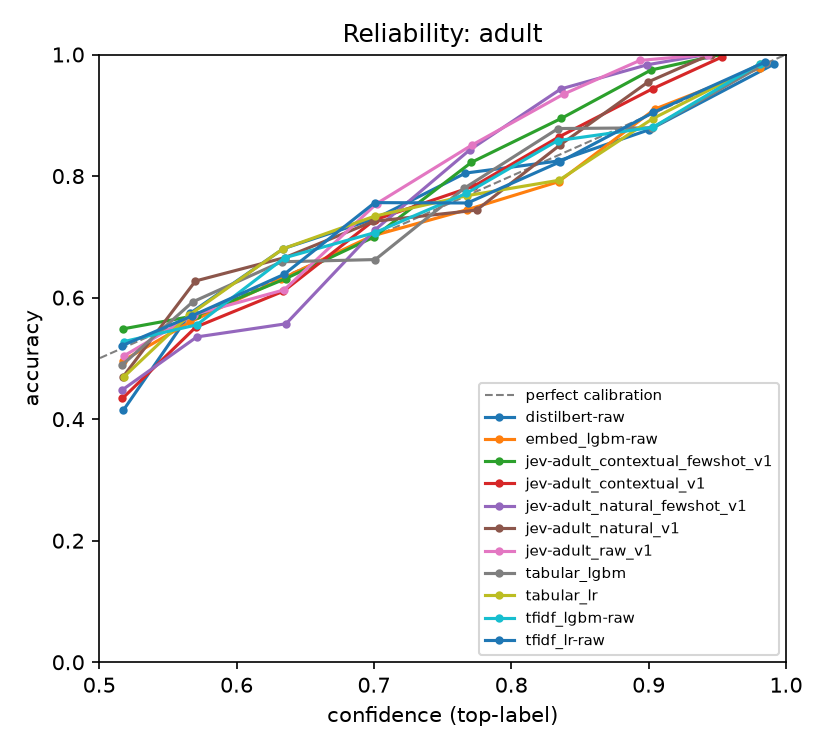
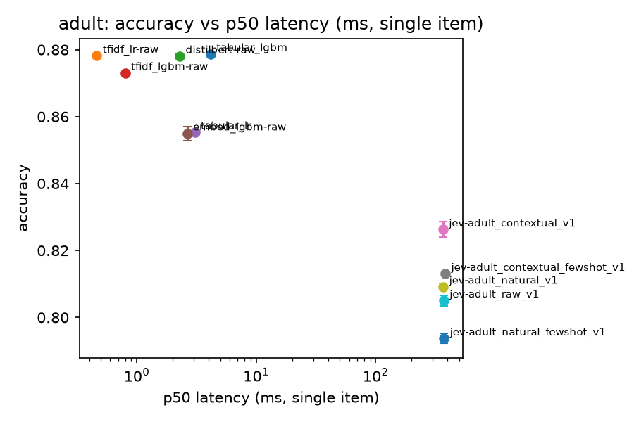
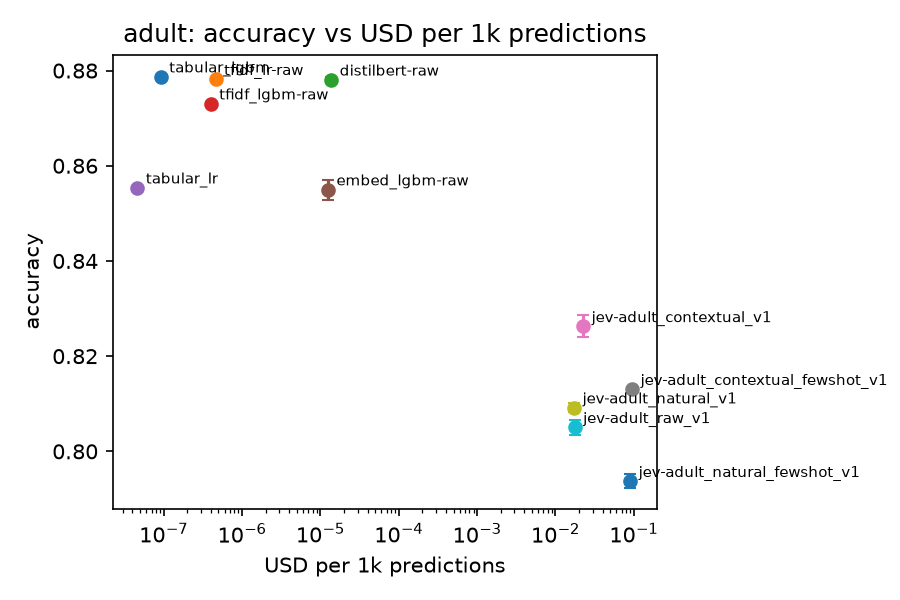
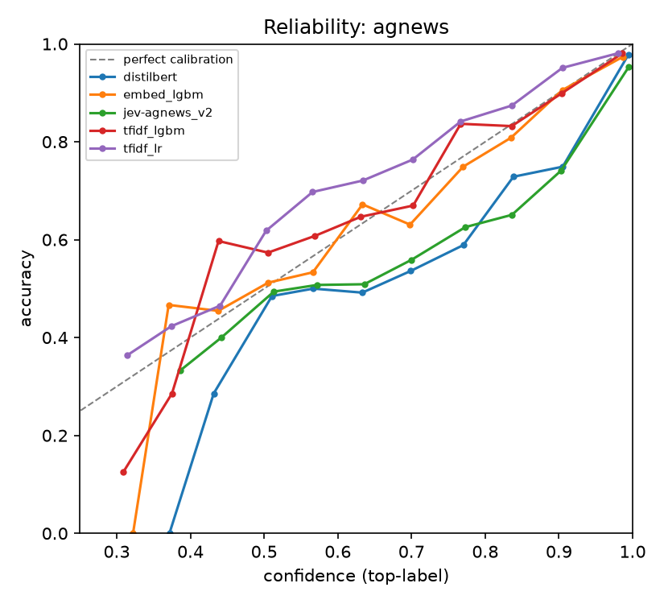
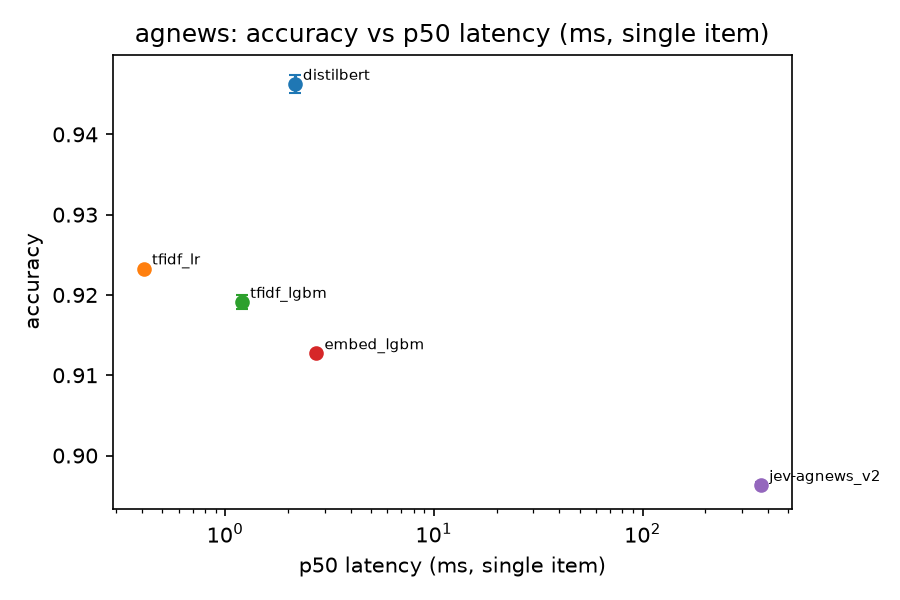
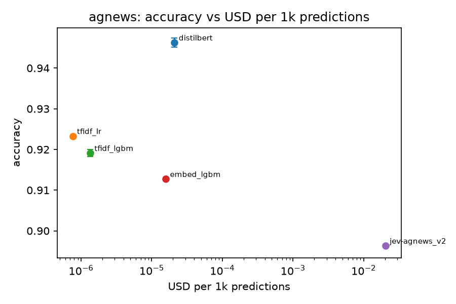
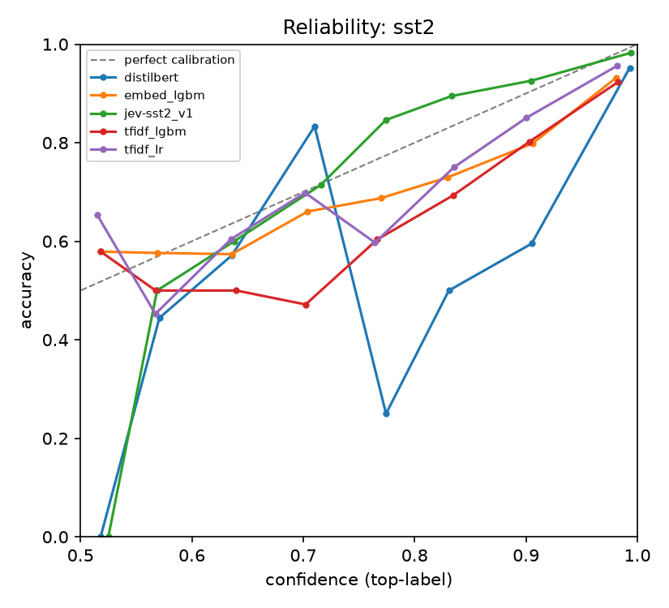
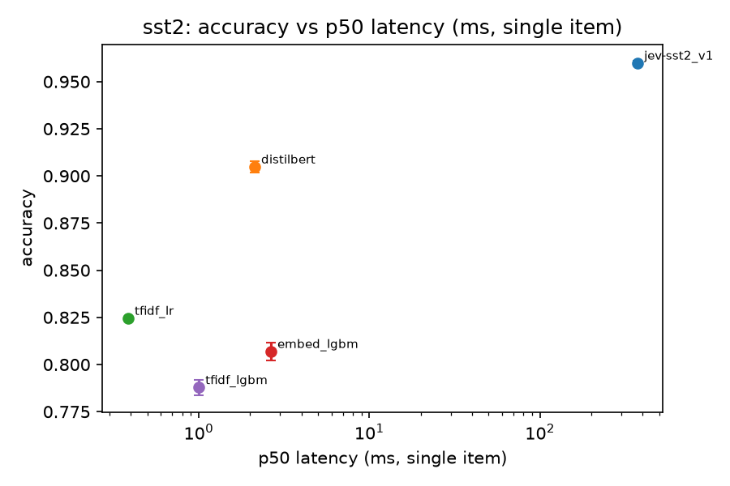
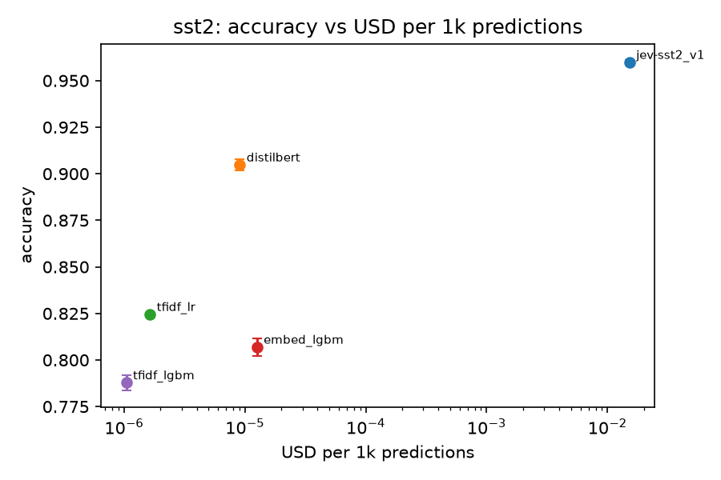

# Jev benchmark summary

Harness version `fe5444fddffa`. Mean ± std over seeds (Jev: repeats).

## adult (track B, n=5000)

| run | seeds | accuracy | macro F1 | ECE | Brier | AUC | p50 ms | p95 ms | $/1k | train $ |
|---|---|---|---|---|---|---|---|---|---|---|
| tabular_lgbm | 3 | 0.8787 ± 0.0003 | 0.8232 ± 0.0007 | 0.0091 ± 0.0032 | 0.1700 | 0.9319 | 4.2 | 7.5 | 9.21e-08 | 4.44e-05 |
| tfidf_lr-raw | 3 | 0.8782 ± 0.0000 | 0.8214 ± 0.0000 | 0.0070 ± 0.0000 | 0.1719 | 0.9293 | 0.5 | 0.7 | 4.62e-07 | 3.00e-05 |
| distilbert-raw | 3 | 0.8781 ± 0.0006 | 0.8204 ± 0.0031 | 0.0149 ± 0.0021 | 0.1716 | 0.9300 | 2.3 | 2.6 | 1.38e-05 | 5.31e-03 |
| tfidf_lgbm-raw | 3 | 0.8731 ± 0.0004 | 0.8150 ± 0.0000 | 0.0094 ± 0.0018 | 0.1798 | 0.9226 | 0.8 | 1.7 | 4.00e-07 | 1.13e-04 |
| tabular_lr | 3 | 0.8554 ± 0.0000 | 0.7866 ± 0.0000 | 0.0136 ± 0.0000 | 0.2034 | 0.9049 | 3.1 | 3.8 | 4.64e-08 | 1.96e-05 |
| embed_lgbm-raw | 3 | 0.8550 ± 0.0021 | 0.7869 ± 0.0030 | 0.0094 ± 0.0010 | 0.2039 | 0.9045 | 2.6 | 3.1 | 1.26e-05 | 1.44e-03 |
| jev-adult_contextual_v1 | 3 | 0.8263 ± 0.0023 | 0.7410 ± 0.0032 | 0.0315 ± 0.0022 | 0.2424 | 0.8629 | 366.5 | 477.1 | 2.27e-02 | 0.00e+00 |
| jev-adult_contextual_fewshot_v1 | 3 | 0.8131 ± 0.0005 | 0.7590 ± 0.0007 | 0.0399 ± 0.0009 | 0.2575 | 0.8749 | 383.2 | 527.8 | 9.56e-02 | 0.00e+00 |
| jev-adult_natural_v1 | 3 | 0.8092 ± 0.0009 | 0.6973 ± 0.0013 | 0.0390 ± 0.0021 | 0.2703 | 0.8295 | 368.5 | 466.6 | 1.74e-02 | 0.00e+00 |
| jev-adult_raw_v1 | 3 | 0.8051 ± 0.0016 | 0.7062 ± 0.0023 | 0.0652 ± 0.0016 | 0.2755 | 0.8331 | 371.1 | 484.5 | 1.77e-02 | 0.00e+00 |
| jev-adult_natural_fewshot_v1 | 3 | 0.7937 ± 0.0014 | 0.7263 ± 0.0014 | 0.0676 ± 0.0012 | 0.2713 | 0.8527 | 373.7 | 513.2 | 9.03e-02 | 0.00e+00 |

## agnews (track A, n=7600)

| run | seeds | accuracy | macro F1 | ECE | Brier | AUC | p50 ms | p95 ms | $/1k | train $ |
|---|---|---|---|---|---|---|---|---|---|---|
| distilbert | 3 | 0.9463 ± 0.0011 | 0.9463 ± 0.0011 | 0.0257 ± 0.0029 | 0.0849 | - | 2.2 | 2.7 | 2.11e-05 | 1.64e-02 |
| tfidf_lr | 3 | 0.9233 ± 0.0000 | 0.9232 ± 0.0000 | 0.0234 ± 0.0000 | 0.1229 | - | 0.4 | 0.5 | 7.64e-07 | 2.50e-03 |
| tfidf_lgbm | 3 | 0.9191 ± 0.0009 | 0.9190 ± 0.0009 | 0.0116 ± 0.0008 | 0.1239 | - | 1.2 | 1.6 | 1.35e-06 | 7.54e-03 |
| embed_lgbm | 3 | 0.9127 ± 0.0003 | 0.9127 ± 0.0004 | 0.0152 ± 0.0012 | 0.1330 | - | 2.7 | 3.3 | 1.59e-05 | 5.75e-03 |
| jev-agnews_v2 | 3 | 0.8963 ± 0.0003 | 0.8957 ± 0.0004 | 0.0586 ± 0.0003 | 0.1651 | - | 369.0 | 457.7 | 2.05e-02 | 0.00e+00 |

## sst2 (track A, n=872)

| run | seeds | accuracy | macro F1 | ECE | Brier | AUC | p50 ms | p95 ms | $/1k | train $ |
|---|---|---|---|---|---|---|---|---|---|---|
| jev-sst2_v1 | 3 | 0.9599 ± 0.0011 | 0.9599 ± 0.0011 | 0.0178 ± 0.0012 | 0.0639 | 0.9879 | 372.6 | 510.3 | 1.53e-02 | 0.00e+00 |
| distilbert | 3 | 0.9048 ± 0.0030 | 0.9047 ± 0.0030 | 0.0662 ± 0.0053 | 0.1563 | 0.9706 | 2.1 | 2.8 | 9.09e-06 | 7.58e-03 |
| tfidf_lr | 3 | 0.8245 ± 0.0000 | 0.8239 ± 0.0000 | 0.0517 ± 0.0000 | 0.2485 | 0.9117 | 0.4 | 0.4 | 1.64e-06 | 5.79e-04 |
| embed_lgbm | 3 | 0.8070 ± 0.0046 | 0.8067 ± 0.0045 | 0.0721 ± 0.0093 | 0.2813 | 0.8905 | 2.6 | 3.5 | 1.26e-05 | 3.32e-03 |
| tfidf_lgbm | 3 | 0.7878 ± 0.0041 | 0.7873 ± 0.0042 | 0.0947 ± 0.0050 | 0.3026 | 0.8797 | 1.0 | 1.1 | 1.04e-06 | 9.49e-04 |

## Jev vs best local model (paired bootstrap, seed 0)

| task | Jev run | vs | Δ accuracy | 95% CI |
|---|---|---|---|---|
| adult | jev-adult_contextual_v1 | tabular_lgbm | -0.0554 | [-0.0656, -0.0460] |
| adult | jev-adult_contextual_fewshot_v1 | tabular_lgbm | -0.0660 | [-0.0766, -0.0554] |
| adult | jev-adult_natural_v1 | tabular_lgbm | -0.0700 | [-0.0812, -0.0600] |
| adult | jev-adult_raw_v1 | tabular_lgbm | -0.0756 | [-0.0864, -0.0656] |
| adult | jev-adult_natural_fewshot_v1 | tabular_lgbm | -0.0868 | [-0.0984, -0.0756] |
| agnews | jev-agnews_v2 | distilbert | -0.0486 | [-0.0551, -0.0421] |
| sst2 | jev-sst2_v1 | distilbert | +0.0573 | [+0.0378, +0.0768] |

## Track B: cost of serialization

| run | accuracy | AUC | ECE | Δ acc vs tabular_lgbm |
|---|---|---|---|---|
| tabular_lgbm | 0.8787 | 0.9319 | 0.0091 | 0.0000 |
| tfidf_lr-raw | 0.8782 | 0.9293 | 0.0070 | -0.0005 |
| distilbert-raw | 0.8781 | 0.9300 | 0.0149 | -0.0007 |
| tfidf_lgbm-raw | 0.8731 | 0.9226 | 0.0094 | -0.0057 |
| tabular_lr | 0.8554 | 0.9049 | 0.0136 | -0.0233 |
| embed_lgbm-raw | 0.8550 | 0.9045 | 0.0094 | -0.0237 |
| jev-adult_contextual_v1 | 0.8263 | 0.8629 | 0.0315 | -0.0525 |
| jev-adult_contextual_fewshot_v1 | 0.8131 | 0.8749 | 0.0399 | -0.0657 |
| jev-adult_natural_v1 | 0.8092 | 0.8295 | 0.0390 | -0.0695 |
| jev-adult_raw_v1 | 0.8051 | 0.8331 | 0.0652 | -0.0737 |
| jev-adult_natural_fewshot_v1 | 0.7937 | 0.8527 | 0.0676 | -0.0850 |

## Jev repeat stability

| task | run | repeats | label agreement | mean max |Δp| |
|---|---|---|---|---|
| adult | jev-adult_contextual_fewshot_v1 | 3 | 0.9864 | 0.0110 |
| adult | jev-adult_contextual_v1 | 3 | 0.9907 | 0.0097 |
| adult | jev-adult_natural_fewshot_v1 | 3 | 0.9871 | 0.0114 |
| adult | jev-adult_natural_v1 | 3 | 0.9920 | 0.0077 |
| adult | jev-adult_raw_v1 | 3 | 0.9903 | 0.0088 |
| agnews | jev-agnews_v2 | 3 | 0.9959 | 0.0045 |
| sst2 | jev-sst2_v1 | 3 | 0.9985 | 0.0041 |
